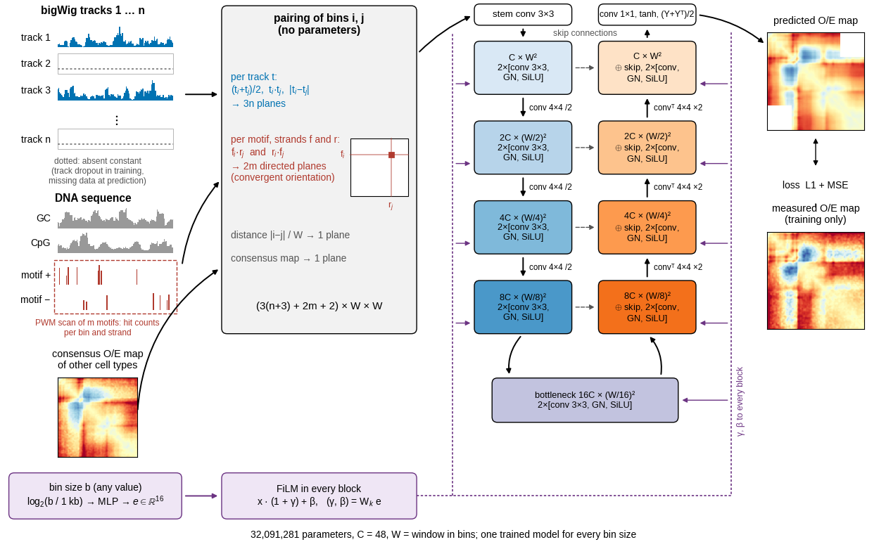
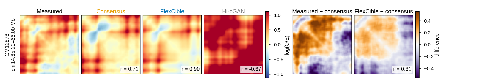
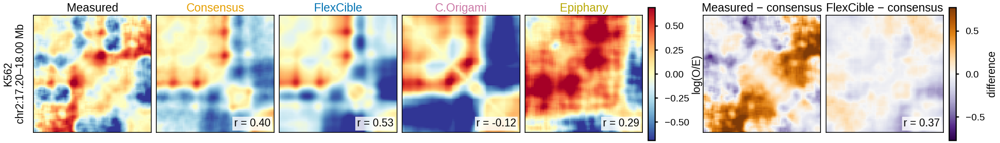
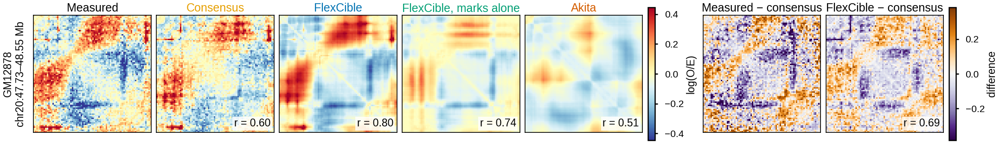
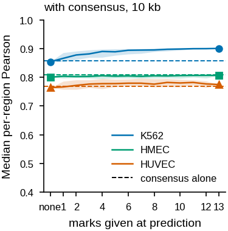

# FlexCible

FlexCible predicts the Hi-C contact map of a cell from its chromatin marks. It reads ChIP-seq or CUT&Tag tracks of CTCF, the cohesin subunits RAD21 and SMC3 and up to ten histone modifications, DNA methylation, the GC and CpG content of the sequence and the positions of CTCF, YY1, ZNF143 and MAZ motifs on both strands. As a further input it reads a consensus, the mean contact map of other cell types, and adapts it with the marks of the target cell. The output is a whole-chromosome contact map in the cool format at 25, 10, 5 or 2 kb, which can be analysed with HiCExplorer, cooltools or any other tool that reads cool files.

Two properties distinguish it from other predictors:

- **Any subset of marks.** During training, marks are removed at random in every window, so one trained model accepts whatever has been measured for a cell. A patient sample profiled by CUT&Tag for CTCF, H3K27ac and H3K27me3 is analysed with the same model as a cell line profiled for all 13 marks.
- **The consensus as starting point.** Most of the contact structure is shared between cell types. The consensus supplies this shared structure, and the network predicts how the target cell departs from it. A cell without any Hi-C data is predicted from its marks and the consensus of the released training cells, which is embedded in every released checkpoint.

*Every track is turned into three planes per pair of bins, each motif into two directed planes, and the consensus and the distance into one plane each; a U-Net with FiLM conditioning on the bin size maps them to the log O/E map. Dotted tracks are absent and replaced by a constant.*

The model is a U-Net with 32 million parameters. It predicts a chromosome in seconds on a graphics card with less than 1 GB of memory at 25 to 5 kb, and in about a minute on eight processor threads without a graphics card.

## Compared with other predictors

The regions below are held out from training. Every panel shows the log O/E map of one region, with the Pearson correlation to the measured map in the corner. The competitors are run with their released weights.

*GM12878 at 10 kb against our earlier Hi-cGAN. The consensus of the other cells already resembles the measured map; FlexCible adds the cell-specific structure, visible as the difference to the consensus.*

*K562 at 10 kb against C.Origami and Epiphany, which predict from CTCF and ATAC-seq or from a set of marks without a consensus.*

*GM12878 on the 2048 bp grid of Akita, which predicts from the DNA sequence alone. FlexCible with marks alone and no consensus is shown next to the full input.*

## Flexible inputs and bin sizes

{ width="360" }

*The same checkpoint predicts from any number of marks. With no mark it returns the consensus; every added mark raises the agreement with the measured map.*

## Where to start

| You want to | Read |
|---|---|
| see the whole pipeline run in a few minutes on toy data | [Quickstart](quickstart.md) |
| predict a contact map for your own cell from its bigWig files | [Predicting with the released models](pretrained.md) |
| train a model on your own Hi-C and ChIP-seq data, from download to evaluation | [Tutorial, A to Z](tutorial.md) |
| look up a configuration field or a command-line option | [Configuration reference](configuration.md), [Command line](cli.md) |

## Inputs and outputs

| | format | notes |
|---|---|---|
| chromatin marks | bigWig, one file per mark, named `<MARK>.bigwig` | ENCODE fold-change-over-control signal or equivalent; any subset of the 13 marks |
| DNA methylation | bigWig of methylation levels (0 to 1 or 0 to 100) | optional |
| genome | FASTA | hg38 for the released human models, mm10 for mouse |
| motifs | JASPAR PFM files, `<ID>.jaspar` | scanned once per genome and cached |
| Hi-C targets (training only) | cool or mcool, balanced | converted to a distance-normalised log O/E map by `scripts/oe_proper.py` |
| consensus (optional input) | cool with log O/E values on the same bin grid | mean of the other cells' O/E maps, `scripts/consensus_oe.py` or `consensus_loo.py` |
| prediction | cool at the model's resolution | log O/E values, or counts with `--obs-exp` off |

## Citation

Wolff J. FlexCible: flexible-input prediction of chromatin architecture from chromatin marks and a consensus matrix. Submitted. The code is released under the MIT licence.
