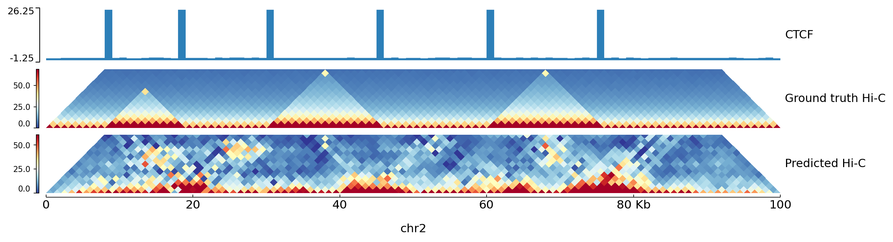

# Quickstart on toy data

This runs the complete pipeline on a synthetic genome in a few minutes on a laptop CPU. The point is to see every step once with small files; accuracy means nothing here.

```bash
bash examples/quickstart/run.sh toy
```

The script does the following, and each line can be run by hand.

## 1. Toy data

```bash
python examples/quickstart/make_toy_data.py toy
```

writes into `toy/`:

- `genome.fa`: three chromosomes of 120, 100 and 90 kb with a planted CTCF-like motif at loop anchors, forward sites upstream and reverse sites downstream, as in real convergent CTCF loops;
- `MA9999.1.jaspar`: the position frequency matrix of that motif;
- `cellA/` and `cellB/`: `CTCF.bigwig` and `H3K27ac.bigwig` at 1 kb with peaks at the anchors; cell B lacks two of the loops and their peaks;
- `cellA.cool`, `cellB.cool`: contact maps with a distance decay, domains between the anchors and loop peaks;
- `consensus.cool`: the mean of both maps after the log O/E transform, the toy stand-in for the consensus of other cells;
- `quickstart.yaml`: the configuration, with chromosomes 1 and 3 for training and chromosome 2 for testing (the split is by parity of the chromosome number: odd chromosomes train, even chromosomes test).

## 2. Precompute

```bash
flexcible precompute --config toy/quickstart.yaml
```

scans the genome for the motif, computes GC and CpG content per bin, fits the per-track normalisers on the training chromosomes, cuts the maps into windows of 32 bins and writes them to `toy/cache/windows`. On real data this step runs once per configuration and takes minutes to an hour.

## 3. Train

```bash
flexcible train --config toy/quickstart.yaml
```

trains a small U-Net (16 base channels, two levels) for up to 40 epochs with track dropout, so that the model learns to predict from CTCF alone, from H3K27ac alone and from both. Training stops when the validation correlation has not improved for 8 epochs. The checkpoint with the best validation score is kept under `toy/run/`, together with the consensus as `embedded_reference.cool`.

## 4. Predict

```bash
flexcible predict --config toy/quickstart.yaml --sample cellA --chroms test --out toy/pred_cellA_chr2.cool --tta
```

predicts chromosome 2 of cell A, the test chromosome, with test-time augmentation (the prediction is averaged with that of the reverse-complement strand). The output is a cool file with log O/E values, since the configuration uses `window.transform: prescaled`.

A cell that is not in the configuration is predicted from its bigWig folder alone; the reference comes from the embedded consensus:

```bash
flexcible predict --config toy/quickstart.yaml --bigwig-dir toy/cellB --cell newcell --chroms test \
    --absent-track H3K27ac --out toy/pred_newcell_ctcf_only_chr2.cool
```

`--absent-track H3K27ac` declares that mark as not measured, so this prediction uses CTCF only. The same mechanism serves a real cell for which only some marks were measured; a mark whose bigWig is missing from the folder is treated the same way.

## 5. Evaluate and plot

```bash
flexcible evaluate --config toy/quickstart.yaml --sample cellA --pred toy/pred_cellA_chr2.cool --chroms test --max-dist-mb 0.05
flexcible plot --config toy/quickstart.yaml --pred toy/pred_cellA_chr2.cool --region chr2:0-100000 --out toy/pred_cellA_chr2.png
```

`evaluate` prints the Pearson and Spearman correlation and the stratum-adjusted correlation coefficient between prediction and measured map on the test chromosome. `plot` draws the measured and the predicted map with the first track above.



*Output of the plot command for the toy run. The toy model trains for a few minutes on a CPU, so the prediction is coarse; the three domains between the CTCF peaks are visible.*

## What changes on real data

- Files: measured Hi-C becomes a log O/E cool from `scripts/oe_proper.py`, the consensus a mean over other cells from `scripts/consensus_loo.py`, the marks ENCODE fold-change bigWigs, the genome hg38 (see the [tutorial](tutorial.md)).
- Size: windows of 80 bins at 25 kb to 512 bins at 2 kb, 48 base channels and four levels (`model.base_channels: 48`, `model.depth: 4`), batch size 3 per GPU, `amp: bf16` and `compile: true`.
- Time: precompute minutes to an hour; training hours to a day on two graphics cards; prediction of a chromosome seconds.
